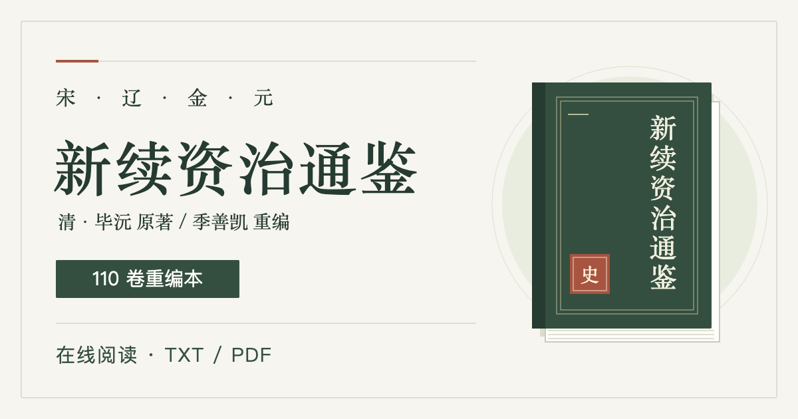

# 新续资治通鉴

清·毕沅 原著，季善凯 重编。

以“资治”为取舍准绳，据《续资治通鉴》裁繁就要，供阅读与交流。

在线阅读：**[《新续资治通鉴》阅读与下载](https://jishankai.github.io/xzztj-book/)**。无需注册，可在线阅读或下载 TXT、PDF。



## 这是什么书，适合怎样读

《新续资治通鉴》以清代毕沅《续资治通鉴》为底本，以“资治”为取舍准绳，裁繁就要，重读宋、辽、金、元约四百年（960—1368年）历史。它不是现代白话译本，也不以替代原著为目的；可直接阅读重编全书，或按卷号、帝号、年号查找分卷。

| 想怎样读 | 入口 | 版本说明 |
| --- | --- | --- |
| 先试读陈桥之变 | [打开卷 001](https://jishankai.github.io/xzztj-book/read/001.html) | 按原书 220 卷卷界组织的分卷文本 |
| 阅读季善凯重编全书 | [110 卷重编本](https://jishankai.github.io/xzztj-book/read/full.html) | 含序、凡例及脚注，与 220 份分卷文本不一一对应 |
| 按帝号、年号找卷或下载 | [目录与下载](https://jishankai.github.io/xzztj-book/#volumes) | 提供在线阅读、TXT 及横排／竖排 PDF |

无需注册。欢迎转发网页链接、提出勘误；公开阅读不等于授予转载或再发行许可。

## 目录

- `index.html`：GitHub Pages 首页，无构建依赖。
- `assets/style.css`：响应式样式，无外部字体、统计或第三方脚本。
- `assets/app.js`：原生 JavaScript 阅读器、目录检索与本地阅读记录，无第三方依赖。
- `assets/share.js`：不依赖第三方服务的原生分享／复制链接控件，权限不可用时展示可手动复制的网址。
- `assets/share-cover.svg`、`assets/share-cover.png`：可维护的分享封面源图与 1200×630 PNG 成品；首页及每个静态阅读页提供 Open Graph / Twitter 卡片信息。
- `assets/landscape.jpg`：首页《千里江山图》公版局部，已压缩为本地 JPEG；来源与权利标记见下方说明。
- `assets/catalog.json`：从分卷原文提取的帝号、年号与卷号索引，随站点直接发布。
- `scripts/build_catalog.py`：可选的内容维护入口，仅使用 Python 标准库；调用 `scripts/build_pages.py` 生成静态阅读页和站点地图。
- `read/001.html`–`220.html`、`read/full.html`：含完整正文的独立静态阅读页，不依赖 JavaScript。
- `sitemap.xml`：首页及 221 个静态阅读页的绝对网址清单。
- `txt/新续资治通鉴.txt`：重编全书（110 卷），含序、凡例及脚注。
- `txt/volumes/001.txt`–`220.txt`：按原书 220 卷卷界组织的文本，与重编 110 卷卷号不一一对应。
- `pdf/`：2026-10-28 编辑审核稿，含横排和右起竖排版本。
- `.nojekyll`：直接发布静态文件。

TXT 采用 UTF-8，已在 PDF 定稿后更新。横排、竖排 PDF 均保留 2026-10-28 编辑审核稿，未同步后续 TXT 修订，其内容、排版及字数脚注不能视为当前 TXT 的排印版。阅读更新后的重编内容请选择全书 TXT；需要当时排版的读者可选择 PDF。

## 本地预览

在项目根目录运行：

```sh
python3 -m http.server 8000
```

打开 http://localhost:8000 。

## 在线阅读

- 首页可打开 110 卷重编全书；分卷目录提供按原书卷界组织的 220 份文本，两者卷号不一一对应。
- 目录支持按卷号、帝号、年号及卷号范围筛选。年代信息取自每份文本的首个 `○` 或 `◎` 标题，不补写原文没有的帝号。
- 首页保留山水主视觉，按“阅读全书 → 分卷目录 → 版本下载 → 关于本书”组织；不再重复展示导览卡片、统计条、试读区或序文全文。《序》《凡例》通过简介中的链接进入全书阅读。使用系统字体，不加载外部字体；阅读正文默认 20px、1.95 倍行距，手机端重排导航、筛选与工具栏。
- 阅读器支持章节／年份跳转、当前正文查找与匹配定位、上一卷／下一卷、字号调整和纸色／夜读主题。正文查找仅针对当前打开的全书或分卷，不是跨文件检索。
- 阅读进度、字号和主题保存在当前浏览器的 `localStorage`，不上传服务器；首页“继续阅读”可恢复最后打开的文本与位置。清理浏览器数据会删除记录，不支持跨设备同步。
- 首页普通点击使用增强阅读器；在新标签页打开或禁用 JavaScript 时进入 `read/001.html`–`220.html`、`read/full.html` 静态全文页，支持原生篇章目录、前后卷导航和原始 TXT 下载。阅读器底部也提供当前正文静态页入口。
- 增强阅读器仍支持 `#read/001`–`#read/220` 和 `#read/full`；浏览器返回键、关闭按钮及 Escape 均可退出。对外引用某卷正文时，优先使用独立静态页网址，而不是首页片段地址。
- 加载失败时可重试，或打开“原始 TXT”。请通过上述 HTTP 服务预览，不要直接双击 HTML 使用 `file://`。静态页使用浏览器原生查找，不提供增强阅读器的主题、字号及进度记录。

## 手动验收

没有配置构建、自动化测试或 lint。修改后通过本地 HTTP 预览检查：

1. 目录卷号／年号检索、范围筛选、无结果提示及重置。
2. 全书与首／中／末卷阅读、正文查找高亮及前后定位、章节跳转、换卷边界。
3. 调整字号与主题，滚动正文，关闭或刷新后继续阅读；检查深链接、返回键和 Escape。
4. 桌面与手机布局、键盘焦点、减少动态效果偏好，以及 TXT 和两种 PDF 的实际链接。
5. 网络加载失败的重试／原文入口、本地存储不可用时的提示，以及项目子目录下的相对路径。
6. 禁用脚本或在新标签页打开目录链接，确认进入含完整正文的静态页；检查静态页篇章跳转、首末卷导航、增强阅读器入口及手机长标题换行。
7. 检查 `sitemap.xml` 中的网址与各页 canonical 一致，生产站点的清单和阅读页返回 HTTP 200。
8. 点击首页、静态页和阅读器的复制按钮，确认得到生产网址；换卷后复制对应卷的静态页而非首页 `#read/…`。拒绝剪贴板权限时，应展示可选取的网址，不显示“已复制”。原生分享取消后不应写入剪贴板。
9. 检查 320px 手机宽度的主视觉、目录、下载和分享控件；无脚本时阅读正文与原生链接仍可用。社交平台是否展示卡片由平台抓取、缓存及规则决定，发布后须在实际平台检查。

## 发布到 GitHub

1. 在 GitHub 创建空仓库，建议仓库名 `xzztj-book`，不要额外初始化 README。
2. 在本地项目根目录关联该仓库（将下方地址替换为自己的真实仓库地址）：

```sh
git add .
git commit -m "Publish Xin Xu Zizhi Tongjian texts and PDFs"
git remote add origin https://github.com/YOUR_USERNAME/xzztj-book.git
git push -u origin main
```

3. 打开仓库 **Settings → Pages → Build and deployment**。
4. Source 选择 **Deploy from a branch**，分支选择 **main**，目录选择 **/(root)**，保存。
5. 等待部署完成，访问 GitHub Pages 设置页显示的地址，通常为 `https://YOUR_USERNAME.github.io/xzztj-book/`。

所有页面资源与下载链接均使用相对路径，可直接部署在项目站点子目录。不需要建立 `gh-pages` 分支，也不需要 Node.js 或 GitHub Actions。

## Google 收录与站外入口

当前生产地址为 `https://jishankai.github.io/xzztj-book/`。首页和静态阅读页均指定 canonical，站点地图包含首页与 221 个静态阅读页；片段地址、TXT 和 PDF 不重复列入地图，原始文件仍可正常访问。提交站点地图不保证收录或排名。

部署本次文件后，使用站主 Google 账号完成以下操作：

1. 打开 [Google Search Console](https://search.google.com/search-console/)，添加 **网址前缀**资源 `https://jishankai.github.io/xzztj-book/`；不要使用需要 DNS 权限的整个 `github.io` 域名资源。
2. 选择 **HTML 文件**验证，将 Google 提供的原始验证文件放在仓库根目录，提交并推送。确认其生产网址可访问后，回到控制台点击验证；验证成功后也不要删除该文件。验证文件与代码仅能由 Search Console 提供，不能自行编造。
3. 在“站点地图”提交 `https://jishankai.github.io/xzztj-book/sitemap.xml`。
4. 在“网址检查”检查首页、`read/full.html` 和代表性分卷，使用实时测试确认可访问，再请求编入索引。之后通过“网页索引”与“效果”报告查看结果，不以 `site:` 搜索有无结果作为唯一判断。

本仓库位于项目子路径，放在 `/xzztj-book/robots.txt` 的文件不能控制域名爬取，因此未创建无效的项目级爬虫配置。参见 [Google 站点地图提交说明](https://developers.google.com/search/docs/crawling-indexing/sitemaps/build-sitemap)。

仓库 README 顶部已提供正式网站链接，发布到 GitHub 后可作为真实站外入口。站主还可在仓库 **About → Website** 填入生产地址，并在自己的个人主页、相关历史阅读项目中按实际内容介绍本站；不批量制造无关外链。可用的简介为：“《新续资治通鉴》，清·毕沅原著、季善凯重编。提供 110 卷重编全书、按原书卷界组织的 220 份分卷文本，以及在线阅读和 TXT／PDF 下载。”

Search Console 账号验证、提交索引、仓库 About 和个人主页发布均需要相应账号权限，修改本地文件不会自动完成这些操作。迁移域名时，同步修改首页 canonical 和社交卡片网址、`scripts/build_pages.py` 与 `assets/share.js` 中的生产地址并重新生成，再更新本文链接及 Search Console 资源。

## 推广执行与可用文案

先把页面发布并确认公开网址返回 HTTP 200，再推广；不要把尚未上线的新链接发给读者。网站配置、封面和文案本身不会自动带来曝光。本仓库没有安装访问统计；不能把转发次数、Star 数或抓取成功当作实际阅读人数。

### 优先发布到哪里

| 顺序 | 渠道 | 发什么、怎么发 |
| --- | --- | --- |
| 1 | GitHub 仓库 About、作者个人主页 | 填写图书简介、正式网址和相关主题标签，把已有访问导向阅读站 |
| 2 | 作者自己的朋友圈、公众号或读书群 | 先发布下方短介绍，配分享封面；读书群先征得管理员同意，不群发私信 |
| 3 | 允许作品介绍的宋史／元史／古籍阅读社区 | 用下方陈桥试读帖，说明与项目的关系；先看版规，不假装独立读者推荐 |
| 4 | 历史类公众号、读书通讯、资源目录维护者 | 逐一提出是否愿意介绍本书，提供网址、版本说明和封面；转载正文须另行确认授权 |
| 持续 | 上述已接触的读者 | 根据真实反馈补充勘误或阅读说明；每次分享一个有出处的问题，不重复刷同一广告 |

仓库展示信息可在登录 GitHub CLI 后设置（以下命令仅修改 About，不提交代码或发帖）：

```sh
gh auth login
gh repo edit jishankai/xzztj-book --description '《新续资治通鉴》：清·毕沅原著，季善凯重编；宋辽金元历史，在线阅读与 TXT、PDF 下载。' --homepage 'https://jishankai.github.io/xzztj-book/' --add-topic chinese-history --add-topic chinese-literature --add-topic digital-humanities
```

### 短介绍：适合朋友圈或读书群

> 想从《资治通鉴》继续读到宋元，可以看看《新续资治通鉴》：清·毕沅原著，季善凯重编，以“资治”为取舍准绳，裁繁就要。网站提供 110 卷重编全书和按原书卷界组织的 220 份分卷文本，也可下载 TXT、横排及竖排 PDF。无需注册，先读一段，再决定是否继续。两个版本的卷号不一一对应。
>
> 阅读与下载：https://jishankai.github.io/xzztj-book/

### 试读帖：从陈桥之变开始

**标题：黄袍加身之后，赵匡胤首先约束将士做了什么？**

> “匡胤揽辔约诸将，不得惊犯宫阙、侵凌朝贵、侵犯府库，用命厚赏，违则孥戮，众皆听命。”
>
> 这段文字见本站《新续资治通鉴》按原书卷界组织的分卷文本卷 001。熟悉的“黄袍加身”之后，接着读到的是军纪、入城和政权交接。不必一开始就通读全书，可以先从这个片段读下去。
>
> 试读：https://jishankai.github.io/xzztj-book/read/001.html
>
> 版本说明：试读链接按原书 220 卷卷界组织；网站另有季善凯重编的 110 卷全书，两者卷号不一一对应。清·毕沅原著，季善凯重编。

### 长介绍开头：为什么又有一部“新续”

**标题：不只是少读一些：怎样理解《新续资治通鉴》的取舍**

> 《新续资治通鉴》的序中写道：“取舍之准，不在文字多寡，而在有无鉴戒之益。”它以毕沅《续资治通鉴》为底本，重编为 110 卷，保留编年次序，以国家兴亡、君臣得失、制度利弊等为取舍重点。想了解重编的边界，建议先读序和凡例，再看正文，而不是把它当成现代白话译本或未经改动的原著。
>
> 序、凡例与重编全书：https://jishankai.github.io/xzztj-book/read/full.html
>
> 清·毕沅原著，季善凯重编。欢迎指出文字、史实和编订问题；勘误请注明文件、卷号及原句。

以上是待发布文案，不代表已经向任何平台投稿或获得推荐。作者或项目维护者发布时应如实说明身份；其他读者不要照搬第一人称经历或虚构阅读评价。

### 分享功能与封面维护

首页可分享整本书，静态页分享当前页，增强阅读器分享当前文档的静态页。优先使用浏览器原生分享；也可复制链接。原生分享不可用时只显示复制按钮，复制失败时显示可选取的网址；不上传正文，不接入社交 SDK 或跟踪参数。转发链接不意味着授权转载全文。

封面源文件为 `assets/share-cover.svg`，卡片实际引用 `assets/share-cover.png`。修改源图后，用浏览器以 **1200×630、设备缩放 1** 打开 SVG，等待字体加载后截取页面为 PNG，并替换成品；维护脚本不会自动重绘图片。封面未使用第三方图片、字体或脚本。实际社交平台可能不读取 Open Graph，或缓存旧卡片；不能承诺每个平台都显示同样预览。

## 更新内容

替换对应 TXT/PDF 后执行 `git add .`、`git commit`、`git push`；Pages 会按分支重新发布。PDF 若更改文件名，请同步修改 `index.html` 中的链接与版本说明。

2026-11-02 已依据 `txt/新续资治通鉴.txt` 同步 `001.txt`–`220.txt` 的正文、帝号及纪年，保留原书卷界、三位数文件名和卷内段落编号，并补入全本的年号标题。分卷合并后，去除分卷标题、段落编号及重复的卷首帝号／年号，正文与全本一致；全本的序、凡例、110 卷编排说明及书末脚注不分配到这 220 份文本，PDF 未改动。

以后依据全本同步分卷时，须按史事核对原书卷界，不能把重编本的同号卷直接覆盖分卷，也不能将每卷机械二等分。下列脚本只从现有 TXT 生成网站资源，不负责同步或拆分正文。

修改重编全书 TXT、分卷 TXT 或静态页生成逻辑后，重新生成并一同提交目录、静态阅读页、首页目录及站点地图：

```sh
python3 -B scripts/build_catalog.py
```

脚本以自身路径定位项目根目录；从其他目录调用时，请使用脚本的绝对路径。它生成 `assets/catalog.json`、221 个 `read/*.html`、首页目录和 `sitemap.xml`，不是部署前必须执行的构建；已提交文件可直接由静态主机提供。`-B` 避免生成本地 Python 字节码缓存。脚本保留原文标题与用字，不生成 PDF，也不改写正文。不要单独手改生成的阅读页或目录卡片，否则再次生成会覆盖；若调整分卷文件数量或命名，还须同步修改生成脚本及阅读器卷号边界。

## 权利说明与勘误

原著：清·毕沅。重编：季善凯。本仓库未另行授予开放许可；公开阅读不等于允许任意转载或再发行。对重编内容的授权由权利人另行决定。

首页绘画为北宋王希孟《千里江山图》局部，来源：[Wikimedia Commons 原文件页](https://commons.wikimedia.org/wiki/File:Wang_Ximeng_-_A_Thousand_Li_of_River_(Bridge).jpg)，该页标记为 Public Domain（PD-Art / PD-old-100）。本站将其缩小为 3200×683 JPEG，并按屏幕裁切展示；该图像的公版说明不改变重编书籍的权利状态。首页视觉仅参考 Google Arts & Culture 的展览式排版，不使用其品牌标识，也无关联或背书关系。

发现文字、史实或排版问题，可通过 GitHub Issues 提交，注明文件名、卷号与相关原文。
